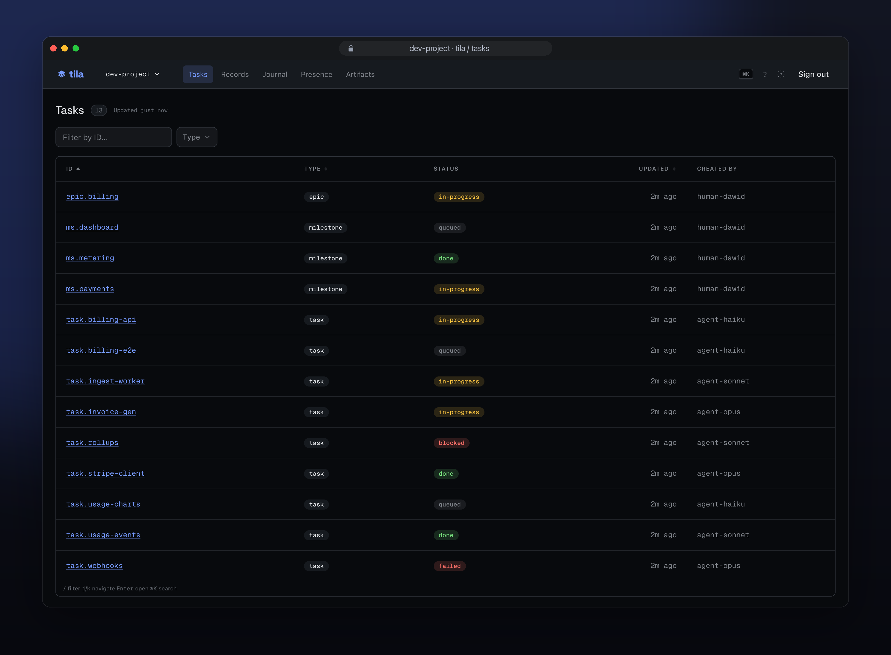

<div align="center">

# tila

**Self-hosted development management for humans and coding agents.**

Durable project state, assignments, questions, decisions, results, and handoffs.<br>
Content-addressed artifacts and coordination protected by fencing tokens.

Deploy to your own Cloudflare account, or run locally with zero infrastructure.

> **Status:** v0.12.1 — APIs may change before v1.0. Upgrade the CLI and SDK for reliable long-running cloud exports; this patch requires no Worker deployment or migrations. If upgrading from an earlier release, follow the intervening upgrade notes first. Details are in the [v0.12.1 notes](CHANGELOG.md#0121---2026-10-17).

</div>

tila is one development-management product with a reusable state-and-coordination
core. The Cloudflare deployment holds shared project state; CLI, MCP, SDK, and web
clients use its service contracts.

**Delivered as of v0.12.0:** schema-defined tasks and records, claims/fences, artifacts,
journal cursors and handoffs, conversations, and a managed work queue with durable
assignments, attempts, questions/decisions, and explicit results. An attempt is one
execution of a task; its result is recorded separately from task and terminal state.

**Direction and remaining acceptance:** the first live workflow is one orchestrator
coordinating workers across Mac/Linux hosts. Host runtimes own processes, terminals,
and model retries; tila owns durable assignments, decisions, work retry policy, and
supported host-adapter contracts. The standalone connector and adapter contracts
exist, but live cross-host recovery remains unverified. Herdr is under evaluation;
registration and cold opening remain unsupported. Native Mac/iPhone clients, other
topologies, and sandbox scheduling remain roadmap direction. See
[Decisions §0](docs/01-DECISIONS.md#0-name-and-scope--amended-2026-09-20) and
[the active roadmap](docs/03-ROADMAP.md).

**Compatibility:** standalone local persistence and GitHub auth remain implemented.
Local mode, including explicit local MCP, covers a subset of the product. Remote
MCP requires a managed project run or supported session mapping.
Key-only onboarding and retirement of GitHub auth or local persistence require
separate migrations and have not shipped.

**For:** developers and teams coordinating coding agents across worktrees or
machines, and framework authors reusing the same durable coordination core.

---

## Contents

- [Why tila exists](#-why-tila-exists)
- [What it looks like](#-what-it-looks-like)
- [Self-hosted](#-self-hosted)
- [When you need tila](#-when-you-need-tila)
- [Quick start](#-quick-start)
- [For AI coding agents](#for-ai-coding-agents)
- [Monorepo packages](#-monorepo-packages)
- [Related projects](#-related-projects)
- [Contributing](#contributing)
- [FAQ](#-faq)

---

## 🪨 Why tila exists

Agent-produced artifacts (plans, designs, analysis reports, build outputs) pile up fast. Commit them to your repo and they rot in context: coding agents waste tokens parsing stale intermediate files, and your git history fills with noise no human reviews. Gitignore them and they vanish on clone, can't be shared across machines, and agents lose access on context switch. A separate repo just moves the problem.

Development work also needs durable answers to who owns a task, which attempt is
running, what question blocks it, which decision authorizes the next step, and what
result or handoff the next participant should read. Terminal activity alone cannot
answer those questions after a process restart or a change of machine.

tila keeps that work in durable project state alongside typed records and artifacts.
Artifact storage is content-addressed with deduplication, lifecycle, and full-text
search for configured text kinds. Record writes are schema-validated and
revision-tracked. Coordination uses first-writer-wins fencing; stale fenced writes
to tila-managed state are rejected. Consumers must honor claims when editing files
or calling external systems. You deploy to your own Cloudflare account or use the
supported local subset.

---

## 🔬 What it looks like

<p align="center">
  
  <br>
  <sub>The task dashboard: a fleet of agents coordinating on shared state — task hierarchy, live status, and per-agent ownership.</sub>
</p>

### Content-addressed artifacts: immutable and deduplicated

```bash
$ tila artifact put plan.md --kind=plan --resource=T-142 --fence=1
# => Uploaded artifact: produced/T-142/a7f3b2c1d4e5.md (238 bytes, sha256=a7f3b2c1)

$ tila artifact put plan.md --kind=plan --resource=T-142 --fence=1
# => Deduplicated: same sha256, no upload needed

$ tila artifact search "auth migration"
# => 3 results across 2 resources
```

Artifacts are keyed by sha256. Upload the same content twice and it's stored once.
Full-text search covers indexed content. Worker and doctor paths handle cross-store
reconciliation. Immutable revisions, provenance, and version-aware retention are
delivered; see [artifact lifecycle](docs/02-ARCHITECTURE.md#version-aware-retention-and-deletion)
for live-head protection, deletion, and recovery limits.

### Typed records: structured state, not ad-hoc JSON

```bash
# Declare record types in Settings › Definitions (or import tila.schema.toml), then read and write them:
$ tila record set service api ./api.yaml
# => Created record service:api  revision=1  fence=1

$ tila record get service api
# => { "version": "2.3.1", "owner": "platform", "deploy_target": "prod-us" }

$ tila record patch service api --data '{"owner":"infra"}' --fence=1
# => Updated record service:api  revision=2  fence=2

$ tila record history service api
# => r2  2026-05-16T10:35  patch  {owner: "platform" → "infra"}
# => r1  2026-05-16T10:34  set    (initial)
```

Every write is schema-validated. Every mutation requires a fencing token. Every change is revision-tracked.

### Coordination: claims, gates, and fencing tokens

```
Agent A                                Agent B
───────────────────────────────────   ───────────────────────────────────
$ tila task claim T-142                $ tila task claim T-142
=> fence=42                            => 409 already-held by agent-a

$ tila artifact put plan.md \          (waits for A to release)
    --resource=T-142 --fence=42
=> ok                                  $ tila task claim T-142
                                       => fence=43
```

First-writer-wins with monotonic fences. Stale writes to tila-managed state get a 409 instead of silently overwriting newer work. Gates block ready-set selection until external requirements are resolved.

### Core concepts

- **Tasks and attempts** — schema-defined work with durable assignments, execution history, and explicit results on the managed queue
- **Questions and decisions** — attempt-correlated requests, answers, and owner escalation, with authority and revision checks
- **Handoffs and cursors** — durable checkpoints and summaries for resuming project work
- **Journal** — append-only audit log of every state transition (who changed what, when, with which fence)
- **Signals** — lightweight inter-agent notifications distinct from journal events
- **Presence** — TTL'd machine activity tracking across connected agents
- **Schema evolution** — tolerant reads, validated writes, diffSchemas for migration tracking
- **Records** — typed mutable JSON with optional R2 snapshots for point-in-time recovery

---

## 🏠 Self-hosted

tila deploys to your own Cloudflare account (Worker + DO + D1 + R2). There is no tila-hosted control plane for your project data.

- **$5/month Cloudflare paid plan covers most small teams.** Worker, Durable Object, D1, and R2 with included quotas
- **Free tier works for evaluation and light usage.** The 10ms CPU-per-request limit constrains sustained workloads
- **Local mode.** `tila project create --local` stores everything in `~/.tila/` via bun:sqlite. No account needed. Core task, claim, and presence workflows work locally; full CLI parity is still in progress
- **No per-seat pricing.** Costs are Cloudflare usage costs in your account
- **Smart Placement** is enabled by default on the Cloudflare path. Both paths share `@tila/ops-sqlite` for entity, coordination, artifact, journal, gate, and signal logic

---

## 🧩 When you need tila

- You need assignments, worker questions, decisions, results, and handoffs to survive a session or machine change
- Your agents produce artifacts (plans, reports, build outputs) that don't belong in git but need to be durable, searchable, and accessible across machines
- Your agents share typed state (pipeline configs, service catalogs, agent policies, feature flags) and you want schema validation, revision history, and an audit log
- Multiple agents on multiple machines need coordination for shared resources before write time
- You want approval gates that keep blocked work out of the ready set
- You've outgrown "one developer, one laptop, git is enough" but don't want to operate Postgres or Temporal

---

## 🤝 Related projects

These projects cover overlapping parts of coding-agent work. tila combines durable
development management with a reusable coordination core; choosing another task,
memory, or messaging tool depends on the workflow you need. Execution frameworks
and host runtimes can integrate through tila's service and adapter contracts. Host
runtimes retain process/terminal supervision and model retries; tila retains work
ownership, decisions, and recorded outcomes.

| Project | What it does well | Relationship to tila |
|---------|-------------------|---------------------|
| [beads](https://github.com/gastownhall/beads) | Dolt-powered distributed issue tracker with agent memory, dependency graphs, context compaction, and cross-machine sync | Overlapping task management; tila also keeps fenced assignments, attempt results, decisions, typed records, and artifacts |
| [claude-task-master](https://github.com/eyaltoledano/claude-task-master) | PRD-to-task decomposition with dependency graphs and complexity analysis | Planning can feed tila's durable tasks, assignments, and results |
| [ccpm](https://github.com/automazeio/ccpm) | GitHub Issues as coordination hub with automatic worktree isolation | Great choice when GitHub is already your team's project hub |
| [claude-mem](https://github.com/thedotmack/claude-mem) | Semantic memory with vector search across agent sessions | Session memory can complement tila's durable project state and handoffs |
| [mcp_agent_mail](https://github.com/Dicklesworthstone/mcp_agent_mail) | Async agent-to-agent messaging with searchable, threaded conversations | Overlapping messaging; tila also correlates questions and decisions to work attempts |
| [aweb](https://github.com/awebai/aweb) | Agent messaging, task management, and file reservations in one surface | Overlapping coordination and task management; compare the assignment, result, and recovery contracts your workflow needs |

**If you have one developer, one machine, and one agent at a time,** you probably don't need tila yet. Any of the tools above might be a better starting point. tila earns its keep when multiple agents might write to the same resource.

---

## For AI coding agents

The `tila-mcp-server` and `tila-sdk` packages are published on npm (see [latest release](https://github.com/davebream/tila/releases/latest)). The MCP Registry id is `io.github.davebream/tila` (see the [MCP Registry](https://registry.modelcontextprotocol.io)). Three ways to connect:

**1. One command** (auto-detects your editor)
```sh
tila mcp init
```

**2. Explicit managed launch** (after enrollment)
```sh
tila --instance https://tila.example.com --project my-project machine enroll
tila --instance https://tila.example.com --project my-project run exec -- npx -y tila-mcp-server@0.12.0
```

Remote MCP uses a managed project run through a local credential helper or a
supported session mapping. It rejects owner/personal credentials. Generated editor
settings contain only non-secret references.

Explicit local MCP uses embedded SQLite with `TILA_MODE=local`, `TILA_PROJECT_ID`,
and absolute `TILA_DB_PATH` and `TILA_ARTIFACTS_PATH` paths. It supports a bounded
subset of the product and cannot be combined with remote credentials or run
bindings. CLI administration and SDK local mode remain available.

**3. TypeScript SDK**
```sh
npm install tila-sdk
```

Full setup (enrollment, run lifecycle, resources): [`packages/mcp-server/README.md`](packages/mcp-server/README.md)

---

## 📥 Installation

The CLI is published on npm as `tila-cli` (the unscoped `tila` name is taken by an
unrelated project, so it is not used for this CLI). Install it globally:

```bash
npm install -g tila-cli
```

Distribution channels:

| Method | Command | Status |
|--------|---------|--------|
| npm | `npm install -g tila-cli` | ✅ Available |
| Direct download | Grab `tila-<platform>` (+ `checksums.txt`) from the [latest release](https://github.com/davebream/tila/releases/latest) | ✅ Available |
| curl (Unix) | `curl -fsSL https://github.com/davebream/tila/releases/latest/download/install.sh \| sh` | ✅ Available |
| PowerShell (Windows) | `irm https://github.com/davebream/tila/releases/latest/download/install.ps1 \| iex` | ✅ Available |
| Homebrew | `brew install davebream/tap/tila` | ✅ Available; tap updates are published separately |

Update an installed CLI with `tila update`, or preview with `tila update --check`.
The command uses the existing Homebrew/npm/pnpm/Bun installation, or verifies and
replaces a binary installed by the official shell/PowerShell installer. It does
not require a configured project. Older versions without this command need one
normal package-manager upgrade or installer run first. See the
[CLI update guide](packages/cli/README.md#updating-the-cli) for automation and recovery.

**Run from source (for development):**

```bash
git clone https://github.com/davebream/tila.git
cd tila
pnpm install
pnpm --filter tila-cli dev -- --help
```

Use `pnpm --filter tila-cli dev -- <command>` in place of `tila <command>` when
working from a source checkout.

---

## 🏁 Quick start

### Cloudflare path

```bash
tila project create             # provision Worker + DO + D1 + R2
tila task new "Migrate auth"    # create a work unit
tila task claim T-abc123        # acquire a fencing token
tila artifact put plan.md --kind=plan --resource=T-abc123 --fence=1
tila artifact search "auth"     # full-text search across artifacts
```

> Browser access uses invited email/password accounts. Run `tila auth setup` as the infrastructure owner to create the first administrator, then `tila login` and `tila open` for remembered CLI access. GitHub browser sign-in is optional. See [account setup](docs/05-OPERATIONS.md#human-accounts-invitations-and-cli-login).

### Local path

```bash
tila project create --local     # no Cloudflare account needed
tila record set service api ./api.yaml
tila task new "Migrate auth"
# State lives in ~/.tila/<org>/<project>.db, artifacts in ~/.tila/artifacts/
```

See [What it looks like](#-what-it-looks-like) for detailed usage examples with output.

---

## 📄 Documentation

- [CLI Reference](packages/cli/README.md): all commands and workflows
- [MCP Server](packages/mcp-server/README.md): six default workflows, restricted runs, resources
- [TypeScript SDK](packages/sdk/README.md): client API, claims, artifacts, error handling
- [Getting Started Tutorial](docs/tutorial-getting-started.md): from `tila init` to the UI dashboard
- [Architecture](docs/02-ARCHITECTURE.md): full technical spec
- [Decisions](docs/01-DECISIONS.md): product scope, service/host boundary, and correctness guarantees
- [Roadmap](docs/03-ROADMAP.md): active product direction, delivered foundations, and remaining acceptance work
- [Persistence Schema](docs/04-PERSISTENCE-SCHEMA.md): DO SQLite, D1, and R2 layouts
- [Operations](docs/05-OPERATIONS.md): deployment, monitoring, maintenance
- [Search](docs/06-SEARCH.md): searchable artifact kinds and FTS5 usage
- [GitHub-scoped Auth](docs/07-GITHUB-SCOPED-AUTH.md): implemented GitHub compatibility and repository access policy
- [Records](docs/08-RECORDS.md): typed mutable JSON state primitive
- [Shared-Project Coexistence](docs/09-SHARED-PROJECT-COEXISTENCE.md): sharing one project across a framework and direct use

---

## 📦 Monorepo packages

| Package | Description |
|---|---|
| `@tila/schemas` | Zod schemas, canonical JSON helpers, no runtime deps |
| `@tila/core` | Backend interfaces, fence logic, schema evolution |
| `@tila/ops-sqlite` | Shared SQLite operations (entity, coord, artifact, journal, gate, signal, sweep) |
| `@tila/worker` | Cloudflare Worker (Hono routing, Smart Placement), including its Durable Object, D1 and R2 backends |
| `@tila/ui` | Project dashboard with scoped access management and conversations, served by the Worker |
| `tila-cli` | `tila` CLI binary (Bun-compiled), including the bun:sqlite local backend and client-side auth store |
| `tila-sdk` | Typed TypeScript client for framework consumers |
| `tila-mcp-server` | MCP server exposing tila as tools and opt-in resources |
| `@tila/integration-tests` | End-to-end tests via `@cloudflare/vitest-pool-workers` |

---

## 🛠 Development

```bash
pnpm install
pnpm dev:setup                  # Generates dev config, applies D1 migrations, seeds project + token
pnpm dev                        # Source Worker :8787 + Vite UI :5173
pnpm dev:cli --help              # CLI from this checkout
pnpm dev:mcp                    # MCP from this checkout
bash scripts/dev-seed.sh        # Populate with sample data (entities, claims, presence, artifacts)
pnpm test                       # Run test suite
pnpm typecheck                  # TypeScript type checking
pnpm check                      # Biome lint and format check
pnpm build                      # Production build
```

`dev:setup` clears existing local D1/DO state and recreates fixtures. The development
Worker has no built UI assets; use Vite on :5173. Source commands need no package
build or published release. Full tests/typechecks still build dependencies, including
the SDK distribution checks. Source CLI execution uses Bun for `bun:sqlite`; MCP uses Node/tsx.
Bun 1.4.2 can print a nonfatal `directory mismatch` diagnostic with
`--tsconfig-override` ([upstream report](https://github.com/oven-sh/bun/issues/28605));
the source CLI smoke check exits successfully. Production deployments and published
packages still require their normal build steps. `dev-seed.sh` requires the Worker to be running.

## Project backups

Create a complete, portable backup with an absolute output path:

```bash
tila project export --output /backups/my-project.tila-backup
```

The uncompressed `.tila-backup` tar stream includes canonical DO/local SQLite rows, approved D1 project and ACL metadata, artifact pointers, confirmed journal archives, and deduplicated blobs. Every entry and the overall content root are SHA-256 checked. Tokens, token hashes, sessions, rate-limit/idempotency state, revocation material, and deployment-global metadata are never exported.

Restore into a new local project or replace the current project:

```bash
tila project import /backups/my-project.tila-backup --local
tila project import /backups/my-project.tila-backup --replace
tila project import /backups/my-project.tila-backup --resume
tila project import /backups/my-project.tila-backup --rollback
```

Project IDs cannot be renamed during restore. Existing-project restore creates an adjacent timestamped safety archive first. Cloud export freezes writes while reads remain available; restore keeps the destination hidden and write-locked until verification, resume, or rollback completes. See [Operations](docs/05-OPERATIONS.md#backup-and-recovery) for the recovery drill and compatibility rules.

---

## CLI automation and JSON migration

The current CLI uses a common JSON output envelope. Success emits
`{"ok":true,"result":...,"meta":...}` on stdout; failure emits
`{"ok":false,"error":{"kind":"...","message":"...","retryable":false}}` on stderr.
Errors may include `hint` and `details`; partial writes include recovery information
in `details` (such as `partial_result`) and must not be retried automatically.
JSON diagnostics are separate stderr lines with `type: diagnostic`, `level` and
`message`. Parse stdout for results and the final error object on stderr for failures.
Exit codes remain 0/1/2; `doctor` retains its separate pass/warn/fail health meaning.

| Previously | Now |
| --- | --- |
| Command-specific top-level fields | Fields under `result` |
| `entities`, `signals`, other list arrays | `result.items` |
| List count, limit, totals and continuations | `meta.count`, `meta.limit`, `meta.total` when known, and supported continuation fields |
| Top-level error text/code | `error.message`, `error.kind`, `error.retryable` |
| `record patch --json '{...}'` payload | Prefer `--data '{...}'`; the old object/array payload spelling still works. Standalone `--json` selects output. |

```sh
tila --json task list --limit 25 --offset 25
tila task list --json
tila record patch service api --data '{"owner":"infra"}' --fence 1 --json
tila schema --command "task list"        # offline CLI introspection
tila schema show                        # existing project schema
```

Lists retain existing bounded defaults (search/history pages of 20, signal history
and reviews of 50, record lists of 200); otherwise default to 100. Limits must be
positive integers up to 1000, with lower backend caps applied. `meta.truncated`
means more rows are known to exist. `meta.has_more_unknown` means a full page lacks
enough metadata to establish completeness. Neither is a cursor. Artifact reviews
use `--before-revision` with `meta.next_revision`; record lists without resumable
cursors expose truncation without inventing one.

Human output remains the default. JSON, CI, non-TTY stdin and `--non-interactive`
never prompt. Supply required inputs and existing confirmation flags explicitly.
Interactive shells reject these modes before spawning. Global flags respect `--`
and option values; use `--option=--value` for values starting with dashes.

External protocols stay distinct: hooks keep `hookSpecificOutput`/`systemMessage`,
silent paths and advisory exits; background workers stay silent. `auth token`
without JSON emits only the token. Raw `artifact get` preserves stdout bytes and
sends trust metadata to stderr. JSON artifact downloads require `--output <file>`
and return metadata. Provenance, revision creation and review state are preserved;
a matching hash never implies trust.

Generate completions without changing shell profiles:

```sh
tila complete bash > tila.bash
tila complete zsh > _tila
tila complete fish > tila.fish
tila complete powershell > tila.ps1
```

Load the generated script using your shell's completion configuration. Root help
groups canonical commands. Deprecated `entity`/`work-unit` aliases remain functional
but hidden. Typo suggestions never execute the suggested command.

## Contributing

Contributions are welcome. See [CONTRIBUTING.md](CONTRIBUTING.md) for development setup, commit conventions, and PR guidelines.

---

## 💬 FAQ

<details>
<summary><b>Is tila a hosted service?</b></summary>

No. See [Self-hosted](#-self-hosted).
</details>

<details>
<summary><b>Why Cloudflare and not Postgres?</b></summary>

Serializable per-project state, geographic edge placement, and zero ops starting at $5/month. Postgres is excellent but requires you to operate it.
</details>

<details>
<summary><b>Can I use tila without a Cloudflare account?</b></summary>

Yes. `tila project create --local` — see [Self-hosted](#-self-hosted) for details.
</details>

<details>
<summary><b>How does this compare to LangGraph or CrewAI?</b></summary>

tila provides durable development-management contracts: tasks, assignments,
attempts, questions/decisions, results, handoffs, and artifacts. An execution
framework can consume those contracts alongside claims and gates. Host runtimes
own process/terminal supervision and model retries. The first live
orchestrator/worker workflow still has acceptance work; see
[the roadmap](docs/03-ROADMAP.md).
</details>

<details>
<summary><b>How does this compare to beads?</b></summary>

Both cover task management for coding agents. tila combines that workflow with
typed records, content-addressed artifacts, fence-protected writes, durable
attempts and results, and attempt-correlated questions/decisions. Its coordination
core is reusable by other tools. See [Related projects](#-related-projects) for
overlapping capabilities and [the roadmap](docs/03-ROADMAP.md) for remaining work.
</details>

<details>
<summary><b>Why full-text search and not a vector database?</b></summary>

tila's search is keyword retrieval: "find the auth migration plan," not "find documents conceptually related to authentication." FTS5 handles this inside DO SQLite with BM25 ranking, phrase and prefix queries, and transactional consistency with artifact writes, all with zero additional infrastructure. Vector search is the right tool when you need semantic similarity over large corpora with unpredictable terminology, but it requires an embedding model, a vector store, and an embedding pipeline. Those are three new dependencies that conflict with tila's zero-ops design. If your workflow needs semantic search over tila artifacts, a consuming framework can maintain its own vector index via the artifact API.
</details>

<details>
<summary><b>What happens if I lose my Cloudflare account?</b></summary>

Your Cloudflare account holds the durable state. Backups are your responsibility: run `tila project export --output <absolute-path>` and retain the verified `.tila-backup` outside the account. Durable Object SQLite point-in-time recovery remains an additional infrastructure safeguard.
</details>

<details>
<summary><b>Is this stable?</b></summary>

See the [latest release](https://github.com/davebream/tila/releases/latest) for the current version. APIs are stable enough to build against, but expect breaking changes before v1.0. Pin to a specific version.
</details>

<details>
<summary><b>What license?</b></summary>

MIT.
</details>

---

## License

MIT
