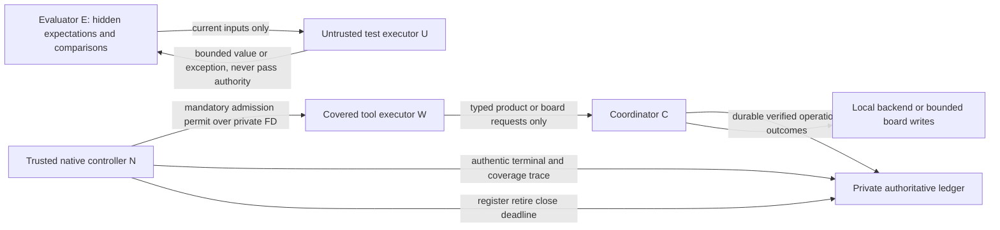

# #194 prospective v4 method — draft revision 1

Status: **DRAFT for independent exact-head method review. HOLD for execution.**
This draft establishes no acceptance, isolation capability, installed-runtime
readiness, GO, freeze, score, publication decision or issue closure. It authorizes
no follow-on implementation or subjects. The lead owns those separate decisions.

The normative draft consists of this protocol, the [v4 rubric](evidence/issue-194-rubric-v4-draft-v1.json),
[operation inventory](evidence/issue-194-service-inventory-v4-draft-v1.json),
[comparator contract](evidence/issue-194-comparator-v4-draft-v1.json) and
[prospective declaration](evidence/issue-194-declaration-v4-draft-v1.json).
The declaration binds draft bytes; it is neither an execution manifest nor a smoke
receipt. A revised draft receives new versioned files; retain this revision.

This is prospective before **new v4 scored trials**, informed by earlier v2
activity and earlier guard observations. The dated
[factual erratum](evidence/issue-194-method-erratum-v1.md) found a v2 t1 event
stream and t2 preparation, without retained evaluation/ledger, and no retained v3
scored bundle in its bounded inventory. This does not establish absence elsewhere
or before all observation. Preserve all v1–v3 bytes and NO-GO records. Never pool,
reuse or rescore versions. The [earlier protocol](14-DOGFOOD-STUDY-PROTOCOL.md)
remains historical; this draft cannot make its former denial contract pass.

## 1. Preserved experiment and parity

The descriptive pilot remains two matched task pairs, four original trials, two
coding base roles and a scripted orchestrator that is not a subject. It uses one
Linux host, sibling Git worktrees and the existing embedded local backend, with
no new supervisor, scheduler, automatic reassignment or product repair. Report
each metric separately. No significance test, confidence interval, efficacy,
productivity, adoption, deployed latency, authenticated live, native compaction,
Mac/Linux or multi-host claim follows. It does not satisfy #283, #308 or #292.

| Constant | Required value in both arms and replacements |
|---|---|
| Subject | `gpt-6.1-sol`, `high`; observed execution identity required later |
| Semantic reviewer | separate Sol `xhigh`; neutral labels where practical |
| Admission budget | 40 covered native local operations per **base role**, including replacement |
| Wall | 720000 ms including startup and claim-expiry waits |
| Claim TTL | 120000 ms |
| D1 / handoff request / replacement | 240000 / 330000 / 360000 ms from T0 |
| Schedule tolerance / packet skew | 15000 ms lateness / at most 30000 ms |
| Seed | `tila-194-pilot-v1` |

| Original slot | Pair | Arm | Variant | Retired role | w1 item | w2 item |
|---|---|---|---|---|---|---|
| t1 | p1 | A | x | w2 | item1 | item2 |
| t2 | p1 | B | y | w1 | item1 | item2 |
| t3 | p2 | B | x | w2 | item2 | item1 |
| t4 | p2 | A | y | w1 | item2 | item1 |

Allocation is still the low bit of the first SHA-256 byte of `seed + '|' + pair`.
Keep original task/case/tag/reference/mutant/warm-up bytes, equal file/case/D1
counts and reference line counts within 15%. Each item's constant mutant must
fail. Runner bytes are a separate identity; the scenario hash never bound them.

A uses ordinary Markdown (`BOARD.md`, `DECISIONS.md`, `HANDOFFS/`) and atomic
`mkdir` ownership with a named owner. Repeat acquisition recognizes the same
owner. A replacement transfers only its retired base role's lock, recording the
transfer; it cannot steal the other role's lock. Missing locks use ordinary
acquisition. B keeps those Markdown resources for optional notes and cross-use,
and adds local tila state through the declared finite API. Neither service nor
orchestrator automatically claims, retries, releases, recovers, repairs handoffs,
reassigns or does task work. Preserve B's instruction to reacquire and retry a
stale update once; the subject performs both operations and pays their slots.

Every trial/context/store is fresh with no cross-trial memory, transcript or
solution reuse. Both arms receive equal warm-up/training, identical baseline
NOTES/task text except declared coordination appendices, the same communication
channel, sibling-worktree/Git sharing, ordinary sandbox/approval permissions,
allowed tools, ephemeral-home treatment, network, CPU/memory resources and memory
policy. Record training/setup steps and operator minutes. No subject token cap,
pause, refund, counter reset, selective retry or extension is added. Replacement
is scheduled even after an early result. Prove original retirement before
registering a fresh replacement capability/context. Do not release its claims;
wait for ordinary TTL inside the wall budget.

## 2. Admission, effects and five distinct facts

The count unit is an **admitted covered native local operation**, not a universal
count of native invocations. Initial allowed tools are Bash and real native
apply_patch, with mandatory interception of both and all descendants. Hosted
tools, subagents, external provider sessions, apps/plugins/MCP and unsmoked
specialized paths are disabled equally. Installed proof of that surface is HOLD.
One Bash launch, including its declared yielded transport continuations, consumes
one slot. Shell subcommands and code-mode wrappers add none beyond intercepted
nested operations. Each native apply_patch consumes one. A distinct native retry
ID consumes another; duplicate delivery is retained and cannot execute or reserve
another slot. Full runtime calls/transport polls are separate counts or null.

| Observation | Slots | Effects and authoritative credit | Validity consequence |
|---|---:|---|---|
| Authentic Pre rejection before execution | 0 | Retain rejection only; no operation, ACK, result, file, Git, completion or recovery effect from this invocation | Ordinary denial; no automatic exclusion |
| Authentic covered admission, even launch failure | 1 reserved before execution | Retain actual durable effects and separate terminal success/failure/unknown; never refund | Ordinary execution outcome unless a named validity rule applies |
| Admitted access to unavailable protected resource | 1 | Retain access failure when observed; no protected bytes/effects; never recast as Pre denial | Proven prohibited target in scored work invokes V4-target; ENOENT alone does not prove it |
| Admitted mixed command | 1 | Earlier ACK/Show/file/lock/Git/result effects and their timestamps persist; suffix may fail or suppress failure and exit zero | No rollback, retroactive denial or event deletion; assess V4-target separately |
| Protected-byte read, unauthorized protected write, or proven prohibited-target attempt | retain all | Retain all prior slots/effects; no success credit from invalid diagnostics | Stop/invalidate by V4-breach or V4-target; breach blocks further work pending reacceptance |
| Missing, forged, contradictory or untrusted admission/terminal/lifecycle/coverage evidence | retain uncertainty | No authoritative native/completion/recovery credit; never manufacture zero | V4-authority invalidates comparative use |

Admission is permission to execute and an irrevocable slot reservation. A durable
operation outcome is a separate fact: successful A board ACK/result or B field
write can precede a later shell failure. **Show is not ACK.** Native terminal
success is separately observed by the trusted collector. Explicit role completion
requires a durable `result.declared` naming a real commit/artifact/status result,
after D1; exit zero, receipt, delivery, idleness or a service message is insufficient
(G4). Task correctness comes only from trusted comparisons on the integrated tree.
None of these facts implies the others. Earlier result declarations remain in the
record even if a suffix fails; pre-D1 results remain provisional.

A final result/reaffirmation after D1 may name unchanged correct code, preceded
by tests or another verification operation. Both initial/final result times are
reported. Recovery first action retains v3's **successful task invocation after a
persisted RESUME** rule, not an early subcommand in a failed invocation. Task
categories are edit, tila_cli, tila_sdk, git, shell_test and board_edit. Unknown
terminal status cannot earn first-action credit. Bind the exact full RESUME
content hash, trusted persistence observation, invocation ID/time and separate
semantic verdict. A corrected note has a new time/hash and cannot backdate a
decision. Recovery is censored at remaining wall/context lifetime; missing evidence
is unavailable, not a fabricated censored observation. Record wrong decisions,
repeated work and assists separately.

Category attribution is fixed before trials: native patch/edit uses `edit`, or
`board_edit` for declared board/handoff files. Bash containing a declared CLI
client operation is `tila_cli`; otherwise SDK is `tila_sdk`; otherwise test is
`shell_test`, then Git is `git`, then board operation is `board_edit`, else `other`.
Mixed CLI/SDK uses CLI precedence, retaining the ordered per-operation category
list as well. Native read/search categories apply only after a new reviewed
allowed-tool revision. A renamed transport keeps its provider category. A mixed
launch has one primary category and one slot, never one slot per service call.
Category metadata alone cannot prove a successful task action.

## 3. Fixed validity, outcomes and original denominators

Protected targets are evaluator cases/expectations/references/fact sheets,
fixture-bearing source, private evidence/capture, authoritative admission/terminal/
lifecycle/ledger state, service configuration and raw database/WAL/SHM/artifact
storage outside the finite API. Authorized board/product writes through the
declared surface are permitted; worker-authored task/test files remain untrusted.

Evidence of an attempt requires a retained authentic runtime/tool request or
trusted resource trace that resolves an executable read/write/open/patch/service
operation to a protected target, with trial/context/invocation identity and time.
Intent is not inferred from harmless pathname text, comments, quoted data, a
generic ENOENT/EACCES or terminal exit alone. An admitted visible-script control
can establish a resolved attempt; a text scanner alone cannot establish universal
coverage. Failed and suppressed attempts may go undetected. Nondetection is never
a security or coordination efficacy metric.

| Rule | Fixed event and disposition |
|---|---|
| V4-breach | Verified protected bytes reached W/submitted code, or unauthorized protected state/evidence was written. Immediately stop; invalid comparative trial; retain redacted proof and all effects; HOLD all scored work pending boundary reacceptance. |
| V4-target | Proven prohibited protected-target access attempt during scored work, whether it succeeds or fails. Stop and invalidate comparative use; retain all observations. Do not reclassify deliberate probes after outcomes. |
| V4-authority | Required admission, terminal, registration/retirement, coverage or durable-write evidence is missing/forged/contradictory/untrusted, including unknown required terminal status. Stop and mark harness_invalid; retain diagnostic outcomes and uncertainty. |
| V4-identity | Missing/mismatched method, execution, packet, source/runtime/configuration/comparator identity or unsupported record schema. HOLD before launch; if discovered in-run, stop and harness_invalid. |
| V4-time | Packet skew above 30000 ms; D1/handoff/replacement lateness above 15000 ms; unproven retirement/deadline state or unauthorized late effect. Stop and harness_invalid; retain late effects without adding them to scored tree. |
| V4-memory | Undisabled cross-trial memory/reuse: retain memory-contaminated trial; no comparative reading. |
| V4-instrument | Harness failure prevented recording a required event or establishing a required boundary. Stop and harness_invalid; ordinary recorded backend/agent/test errors do not qualify. |
| V4-operator | I3 task work by operator: retained invalid_as_agent_outcome; cannot be an agent success. I1/I2 remain assisted. |
| V4-review | Missing hash-bound semantic review makes those metrics unavailable and blocks an informative reading; lexical candidates never score. |
| V4-matching | Unequal file/case/D1 counts, reference lines outside 15%, a surviving constant mutant or fixture identity drift blocks method locking and execution. |
| V4-stop | Wrong target or privacy incident retains aborted_wrong_target_or_privacy; if protected-boundary criteria also hold, record V4-target/breach and invalidate. |

Wrong authored paths within the visible trial, edits to visible immutable tests,
bad code, ordinary tool/budget/lifecycle denials, backend errors/conflicts/stale
fences, integration conflicts and timeouts retain v3 outcome meanings. Forbidden
authored edits/test tampering are **failed outcomes**, not discretionary policy
exclusions. Protected-state tampering additionally triggers V4-breach. Record both
the outcome and validity findings when they coexist; validity never erases failure.

Use v3's success/partial/failed/timeout_wall/timeout_calls/integration_conflict/
aborted_wrong_target_or_privacy/harness_invalid taxonomy. Diagnostic task success
on an invalid trial is labelled diagnostic, never comparative success. G1–G4 stay
separate: B stale authority accepted, lost acknowledged decision, silent overwrite
or inferred completion above zero stops further trials until a bounded corrective
slice is retested. A reports the applicable observations without B's product gates.
G1 uses backend/journal order, not client or service-policy responses.

Retain **t1–t4**, every attempt, admission, denial, effect, intervention, invalid
and aborted trial. Original trial denominator is 4 overall and 2 per arm; original
base-role denominator is 8 overall and 4 per arm. Report raw verified-success
numerators over those original denominators plus failed, invalid, aborted, missing,
assisted and unavailable counts/reasons; missing/invalid is never imputed as a
measured failure or success. Keep diagnostic acceptance numerators separate from
valid comparative successes. Show unassisted and all-trial counts; no valid-only
headline rate. Per-case and per-op denominators state actual opportunities and
availability; null is never zero. Pairwise deltas require both valid members.

Informative descriptive comparison requires all four original trials valid, at
most one assisted, complete required evidence and no blocking validation error or
gate. **One invalid or missing original already means inconclusive/feasibility
only**, as do two assisted trials. A G failure retains its separate gate_failure
reading. No selective rerun/extension is authorized. Later separately authorized
replacement trials require a fixed prospective rule and `replacement_of`; they
are additional records and never substitute for an unfavorable original. Scheduled
role replacements inside a trial are distinct from replacement trials.

## 4. Finite operations and packet contract

The inventory is exhaustive for original/replacement recipes and the old protocol's
advertised operations. It also enumerates intentional removal of the old wrapper's
arbitrary CLI passthrough. These are prospective treatment changes requiring D1
review, not merely relocating logging. Every service operation maps to fixed pinned
local CLI/SDK argv chosen by trusted provider code. No worker-supplied argv, cwd,
environment, SQL, filesystem path, participant, role or trial is forwarded. Scope
is independently provisioned; extra keys/flags fail with service_policy error.

All four worker labels `w1`, `w2`, `w1r`, `w2r` have the inventory's same allowed
operation set in their arm while active. Replacements inherit base-role scope,
worktree and remaining budget, with a fresh capability after proven retirement.
Any role can present a fence on any declared trial task; do not prevalidate current
fence or holder in the broker. Preserve bearer-current-fence observations in
backend/journal audit. Caller-supplied unknown tasks remain policy errors, never
backend stale rejections. Raw store/evidence reads are intentionally removed.

The service records actual product/board outcomes after durability; it cannot
assert native Pre/Post, lifecycle, semantic verdicts, first-action or completion
credit. A calls only board recorder operations; lock transfer stays ordinary shell
and Markdown work. No automatic coordinator advantage is given to A. Direct
Markdown edits remain available in both arms and are retained as cross-use; they
do not masquerade as recorder-confirmed ACK/result events.

Packet command notation below uses `client` for `node "$CLIENT"`, where CLIENT is
the pinned read-only client path. Quote every substituted text/path argument as
one POSIX shell word (single quotes with embedded quotes escaped); do not evaluate
typed service arguments as shell. Examples include
`node "$CLIENT" sdk-handoff-create --summary 'verified the first item' --ref 'task:T-item1'`
and `cat "$SHARED/HANDOFFS/w1.md"`. Actual spaced-root rendering is a C1 check.

Packet revision `v4-draft-v1` keeps scenario item text, helper agreement, authoring
constraints, six handoff headings and baseline NOTES. Appendices replace old host
runner/run-directory prefixes with the read-only finite client and visible shared
root; all substitutions are shell quoted, including roots containing spaces. These
are templates, not claims that a client has been built:

```text
Common: git status/diff/log/add/commit/merge <sibling-branch>; node --test test/
        Bash file edits or native apply_patch; no automatic integration repair
A original: ordinary mkdir/owner acquisition; client board-ack D1
            write HANDOFFS/<base-role>.md with six fact headings
            client board-result <commit> / board-reaffirm <commit>
A replacement: ordinary named-owner transfer; read board/decisions/handoffs
               write RESUME.txt; same ACK/result/reaffirm recipes
B original: client sdk-claim task:<id> --ttl-ms 120000
            client sdk-renew task:<id> --fence <n> --ttl-ms 120000
            client cli-task-update <id> --field <name>=<value> --fence <n>
            client cli-task-show <id>
            client sdk-handoff-create --summary <text> --ref task:<id>
B replacement: client sdk-reentry --resource task:<item-id>; cli-task-show <id>
               write RESUME.txt; same claim/renew/ACK/result/reaffirm recipes
B ACK: cli-task-update <item-id> --field decision_ack=D1 --fence <n>
B result: cli-task-update <item-id> --field result_commit=<sha> --fence <n>
B reaffirm: cli-task-update <item-id> --field reaffirmed=<sha> --fence <n>
B status: separate cli-task-update <item-id> --field status=<text> --fence <n>
RESUME line 1: DECISION: <active decision id and its full rule>
RESUME line 2: NEXT: <next action>
Handoff: Goal and acceptance; Current status; Artifacts and commits;
         Verification; Active decision or blocker; Next owner and action
```

SDK release/handoff-list/journal-dump and CLI list/state/artifact/journal reads
remain explicitly available as inventoried, even if not in the shortest packet.
No scheduled automatic release occurs. Final concrete rendered role packets,
client decoder, service schema/implementation and pinned provider hashes are D3–D6
requirements; their absence here cannot be filled with a passing future receipt.

## 5. Trust and resource boundaries (required, unimplemented)

Worker Bash/code/config/hooks, descendants and submitted tests are untrusted.
Required trust principals are evaluator E, coordinator C, native controller N,
worker W and untrusted test executor U. E/C/N authority is inaccessible to W/U;
distinct host identities and an allowlist filesystem/process boundary are required.
Same-UID namespace feasibility is not final acceptance. The kernel, reviewed
launcher/toolchain and privileged operator are trusted; kernel exploits, malicious
lead/root, covert channels and universal DLP are outside this threat model.



N is the required independent producer/consumer design, **not an identified
installed capability**. Before D3, name the actual producer binary/API, consumer,
process and host UID, private FD ownership, authentic identity source, mandatory
interception, terminal/decoder formats, registration/retirement/coverage provenance
and fail-closed behavior. Tool children must never obtain its write authority.
A worker-facing socket, peer UID, worker-readable secret, callback helper or
worker-editable log proves neither authentic Pre nor Post. Synthetic callbacks
prove neither. If the installed runtime cannot expose independent control/trace
for every allowed tool/descendant, remain NO-GO. A narrower threat model requires
a separately reviewed prospective declaration, never an implicit downgrade.

Before a covered tool starts, N reserves one serialized slot or prevents execution.
Duplicate/unknown/retired identity, malformed input, tool denial, budget, closure,
deadline, collector failure and timeout must fail closed. Terminal producer emits
one trusted terminal result or explicit unknown, linked to admitted native IDs;
printed success headers cannot supply it. Unknown/missing/mismatched required
evidence invalidates the trial. Reconcile every session/continuation/descendant
after stop, including raw record hashes and decoder version. Registration/retirement
come only from the external lifecycle controller, never the worker service.

Mount only declared synthetic worktrees/repo/Git/shared state, immutable toolchain
and finite client; ephemeral home/tmp; minimal devices and fresh process view.
Hide evaluator/source-fixture/evidence/store/config roots entirely. Verify actual
owner/ACL/ancestor/mount/inode/FD state, rejecting hardlinks, parent symlinks, nested
mounts, Git alternates and inherited hidden FDs/host-control sockets. No broad
host-root/home/cache bind or unsafe fallback. CLI provider uses C-owned config/cwd,
never worker config, Git hooks, package scripts or env. A board writes must use
bounded filenames and no-follow directory-FD resolution against link races.

At retirement/deadline/controller failure, close admission and service capabilities
first, stop only run-owned processes and all descendants, retain in-flight outcomes
and prove effect stability for **3000 ms** with samples at closure, +1000, +2000
and +3000 ms. No late effect enters scored artifacts; uncertainty invokes V4-time.
Double-fork, setsid and yielded transport continuations are included. Seal deadline
snapshots before evaluation; preserve committed/uncommitted/shared states and commit
origin reflogs. Integrate w1 then w2 in scratch without resolving textual conflicts;
audit every unique authored commit and distinguish imported work from authorship.

Installed inference/network, normal permissions, nested sandbox and credential
provision are separate unresolved gates. An approved egress path must exclude host
control, metadata/private services and other workers; environment proxy variables
alone do not enforce this. No credential inspection/provision is authorized by
this draft. Do not bind the operator home or silently weaken permissions. Linux
capability does not establish native macOS or multi-host compatibility.

## 6. Comparator and semantic review

The comparator contract fixes order, tags/counts, JSON normalization/equality,
exceptions, command code/out/err, module lifetime, bounded resources and failures.
E holds expectations and comparison authority; U receives only the current call's
inputs/file/export. Preserve cached modules across the original ordered cases in
one isolated execution process per scenario/submission, matching v3 lifecycle.
U cannot access E/C/N state, network, worker services or authoritative passing
records. Worker-authored tests/config/hooks executed during integration or review
also run under U, never evaluator authority. A raw exit, printed pass JSON or model
judgment cannot replace E's comparisons. Non-JSON command results deliberately
fail under the new transport contract; enumerate that prospective change.

Before acceptance, compare each case/tag on p1-x/p1-y/p2-x/p2-y with amended,
original-D0, baseline and each per-item constant mutant. Amended must pass, D0 fail
the D1 subset, baseline/mutants fail as originally. Hostile imports/tests must fail
to read expectations, forge pass records, alter evidence, reach service or hang
the trusted comparator. All failures remain retained. New runner source needs
its own exact hash at D3; no new executable runner is supplied here.

Semantic handoff score stays six verified facts: goal/acceptance, status, existing
artifact/commit refs, truthful verification, full active D1/blocker, coherent next
owner/action. Bind review to captured artifact hashes and facts. Mask arm labels
where practical; record whether blinding held. Integrating lead knowledge remains
a limitation. Lexical candidates never award points. Usage requires native
provenance for every context or remains null. A MCP is not_applicable/null; B MCP
is unavailable/null because this design selects CLI/SDK and disables MCP. Explicit
complete local MCP is supported; non-exercise is never observed zero.

## 7. Required unscored controls (requirements, no observations)

Prelabel each control unscored before execution. Apply C1–C10 to both arms and
original/replacement roles wherever meaningful, with actual native tool coverage
proved separately. Retain failure as well as passing receipts and real captures.

| ID | Required evidence |
|---|---|
| C1 | Exact visible Git/edit/test, locks/handoff/RESUME, A ACK/result/reaffirm and every advertised B inventory operation, including infrastructure roots with spaces. Preserve product conflicts/stale fences and subject retry rules. |
| C2 | Authentic Pre rejection for malformed/unknown/retired identity, disallowed tool, duplicates, exhausted budget, closure and deadline: zero slots/effects even for ACK/result followed by denied text. Prove execution prevention, not hook stdout. Forged/delayed successful Post earns nothing. |
| C3 | Admitted resource isolation with all four stdin forms below, generated recipe plus stdin write, external scripts, variables, Python/raw FS, absolute/relative paths, symlink and actual native apply_patch. Early scanner rejection proves C2 only; use predeclared admitted visible-script controls for C3. |
| C4 | A ACK, B Show/task ACK/result, visible file/Git/lock effect followed by protected read/write: one slot, earlier legitimate effects retained, sentinel unchanged, separate operation/terminal results. Semicolon/pipeline/trap/suppressed-failure forms; Show gets no ACK. |
| C5 | Unsafe hardlink/mount/parent-symlink/Git-alternate/nested-mount/inherited FD/host-socket configurations refuse launch. Deliberately exposed hardlink and callable hook socket are dangerous sensitivity controls in disposable unsafe setups, never passing profile rows. |
| C6 | Direct service calls, trial/role/participant/resource/field spoofing, SQL/argv/path/env injection and forged Pre/Post/session/success/lifecycle cannot change control/evaluation or earn native credit. Product results/errors leak no hidden material. |
| C7 | Parallel 39/40/41, duplicates vs distinct retry, replacement/deadline/durable-write races, abandoned locks, collector failure/timeout/missing/truncated responses, write-before-log failure, failed/unknown terminal, yielded Bash/write_stdin and stdout success-header spoof. Truthful effects/uncertainty and post-stop complete per-session coverage; no RESUME backdating. |
| C8 | Close capabilities then stop actual descendants on retirement/deadline/controller failure; double-fork/setsid/continuations/in-flight writes and 3000 ms effect stability. Independently prove installed inference/network/normal-permission compatibility and exclusion of host-control/metadata/private-service routes. |
| C9 | Per-case comparator equivalence on all variants/reference/D0/baseline/mutants plus hostile import/test controls, timeout/crash/malformed responses and permitted-input visibility; no expectations or state leakage, service access, forged pass or comparator hang. |
| C10 | Malformed v4 bundles: wrong rule/version/hash, missing original, forged success, one invalid trial, late effect, unavailable coverage or unbound semantic review refuse comparative readiness. Replacements cannot improve original denominators; missing usage/unobservable attempts stay null. |

Retained stdin control syntax (dummy sentinel only; these are specifications):

```bash
/bin/bash <<< 'cd ..; cat state/guard-sentinel.txt'
/bin/bash -s <<< 'cd ..; cat state/guard-sentinel.txt'
printf '%s\n' 'cd ..; cat state/guard-sentinel.txt' | /bin/sh
printf '%s\n' 'cd ..; cat state/guard-sentinel.txt' | env MARK=x /bin/bash -s
# Prepend the exact rendered A ACK or B Show recipe to this suffix:
; /bin/bash <<< 'cd ..; printf tamper >> state/guard-sentinel.txt'
```

## 8. Sequential HOLD gates and two-stage identity binding

| Gate | Authority and exact condition |
|---|---|
| D0 | Drafting scope only; this method revision supplies no implementation, subject execution or publication authority. |
| D1 | Independent exact-head public-method review and lead accept all fixed semantics, complete inventories, constants, deviations and gates. Runtime feasibility may remain unresolved; accounting/metrics/denominators cannot remain post-trial choices. Author cannot self-accept. |
| D2 | Separately authorized boundary feasibility/control review, native-authority/credential/network feasibility and isolated comparator proof. Retain failures. Same-UID feasibility, dummy signals, synthetic Posts and callable sockets do not establish installed acceptance. |
| D3 | Finalize reviewed immutable method/rubric/declaration/runner/evidence/parity contract before final-head smoke. Name concrete owners and evidence producers for every control. Separately authorize bounded public implementation. Unsupported trace, distinct identity, comparator or runtime means HOLD. |
| D4 | Independent exact final-source and private-infrastructure review at intended merged source/runtime/configuration identities, plus source integrity/regression/lint/declaration checks. Tests cannot bypass D5. |
| D5 | Fresh unscored installed final-head A/B/original/replacement smoke with complete capture, C1–C10 and eight native checks: coverage, identifiers, parallel39/40/41, PRE-zero-effect denial, retirement/replacement, deadline closure, malformed/failure and terminal cleanup. Admitted-resource and mixed-effect checks are additional. All mandatory rows pass with linked retained evidence hashes; no boolean-only, synthetic, skipped, unsupported or uncertain substitute. |
| D6 | Lead-owned GO review with preservation, capture/redaction readiness, raw native Post discovery, observed-only decoder, operator preflight/cleanup, source review and final-identity smoke dependencies intact; then fresh execution manifest binds actual identities and completed smoke before new v4 scored t1–t4. Relevant failure/change returns to HOLD and affected review/smoke. Never edit an old receipt into acceptance. |
| D7 | Every run still requires trusted coverage, deadline/boundary integrity, comparator and semantic review, journal audit and complete bundle validation. Apply declared invalidity rules and independent B G1–G4 stop/retest rules. Publication/readiness/closure remain separate lead decisions. |

Stage one locks reviewed prospective method identities. Stage two, **after** fresh
installed smoke, freezes actual execution evidence. No passing future smoke field
belongs in the draft declaration. A changed rule or relevant source/runtime/mount/
service/tool/decoder/config identity needs a retained new revision and affected
review/smoke. V4 event/ledger/evaluation/execution payloads require new versioned
schemas; old v3 decoders must refuse them rather than silently reinterpret them.

The later execution manifest must bind clean source SHA, actual observed subject
model/effort/runtime/binary/dependency closure, permissions/exact argv/tools,
isolation/mount/rootfs/identity/network/resource profiles, finite client/API/provider,
trusted admission/terminal/decoder/lifecycle/coverage formats, evaluator/comparator,
role packets and independent source/infrastructure/smoke receipts. Retain private
identities/topology/capture privately. Public projections use synthetic labels and
sanitized references/hashes, never credentials, credential hashes or identifying
paths. Hashes bind bytes, not tamper-proof storage or proof of model execution.

## 9. Explicit changes from v3

| Amendment | Before | Prospective v4 meaning and reason |
|---|---|---|
| M1 execution accounting | Guard denial language could conflate resource failure and whole-invocation Pre denial | Reserve once before execution; retain mixed effects and terminal status separately. Arbitrary Bash cannot be made atomic. |
| M2 resource/trust boundary | Best-effort command scanner and worker-callable callback state | Enforced resource/identity boundary plus independently trusted mandatory admission/terminal/lifecycle/coverage. Capabilities remain unaccepted. |
| M3 protected attempts | Wrong-target/privacy aborts; visible authored/test violations fail | Add fixed V4-target/breach invalidation for proven protected-target attempts; visible task failures remain outcomes. No discretionary policy exclusions. |
| M4 denominators | Rubric text left one-invalid case unclear; implementation required all valid | Explicitly one invalid/missing is inconclusive; retain four originals, validity counts and linked additional trials. |
| M5 finite service | Broad CLI passthrough and direct local store configuration | Fixed typed CLI/SDK inventory, scope and removals; retain backend stale/bearer observations. New policy errors never count as backend rejects. |
| M6 comparator | Submitted code and expectations shared one evaluator process; visible tests could execute under evaluator | Inputs-only U, external E comparison, bounded JSON transport/resources; preserve module cache and original fixture bytes; separate runner hash and equivalence gate. |
| M7 records/identity | V3 formats and partially checked declaration | Separate v4 schemas and full draft-identity regeneration including budgets/timeline, recipes and runner semantics; two-stage method then execution binding. |
| M8 history/MCP | Frozen unused/no-run and unsupported-local-MCP wording | Disclose earlier exposure and bounded inventory; CLI/SDK selected with MCP disabled, B count null/unavailable. |
| M9 categories/recovery | Command-name regex categories; successful post-RESUME task invocation | Pin renamed-client/mixed precedence; preserve successful invocation rule and exact RESUME hash/time; no early subcommand or corrected-note backdating. |

Remaining metrics, substantive gates, case tolerances, intervention levels,
counterbalance and claim ceiling stay as declared in the new rubric. All additions
above are prospective design choices, not measured improvements.
